# Laboratorio #3: La carrera contra el reloj

**Asignatura:** Gestión de Servidores  
**Empresa simulada:** SpeedRunners Inc.  
**Entorno de trabajo:** Ubuntu (WSL en Windows) y Docker Desktop  
**Tecnologías utilizadas:** Docker Compose, Nginx, Python, cAdvisor, Bash y Apache Benchmark

## Preparación del laboratorio

Primero verificamos que Docker y Docker Compose estuvieran instalados y funcionando. Como no había contenedores ejecutándose al inicio, pudimos preparar el proyecto sin detener otros servicios. Después creamos la carpeta principal `speedrunners-lab` y, dentro de ella, las carpetas `backends`, `nginx`, `monitoreo`, `pruebas` y `evidencias`.

```bash
docker --version
docker compose version
docker ps

mkdir speedrunners-lab
cd speedrunners-lab
mkdir backends nginx monitoreo pruebas evidencias
```

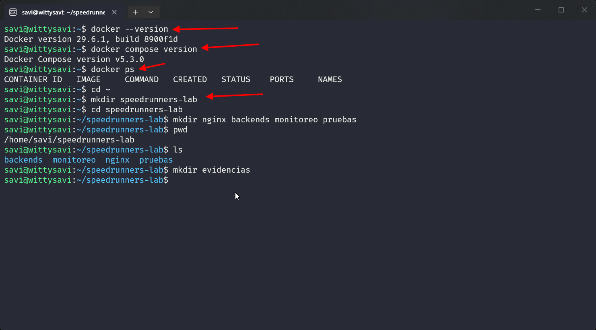

Esta fue la estructura que usamos para organizar los archivos del laboratorio:

```text
speedrunners-lab/
├── backends/
│   ├── Dockerfile
│   └── app.py
├── nginx/
│   └── nginx.conf
├── monitoreo/
│   ├── dashboard.sh
│   └── reporte.html
├── pruebas/
│   ├── antes.csv
│   ├── despues.csv
│   ├── estres_cache.txt
│   ├── estres_sin_cache.txt
│   └── stress-test.sh
├── evidencias/
│   └── imagen1.png ... imagen56.png
├── docker-compose.yml
└── INFORME.md
```

Los archivos de respaldo, registros y resúmenes de las pruebas también quedaron guardados en las carpetas correspondientes. Para no hacer demasiado larga la estructura anterior, solamente mostramos los archivos principales.

---

## Fase 1. Diagnóstico de la infraestructura inicial

### 1. Crear el backend en Python

Comenzamos creando el archivo `backends/app.py` con `nano`:

```bash
nano backends/app.py
```

En este archivo usamos un servidor HTTP de Python que responde con datos en formato JSON. Agregamos un retraso artificial mediante `time.sleep()` y una variable de entorno llamada `DELAY_MS`. Para la primera fase ese valor fue de 500 milisegundos. El contenido repetido de la respuesta también nos serviría más adelante para probar Gzip.

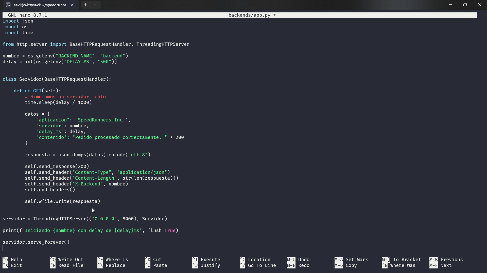

### 2. Crear el Dockerfile

Luego creamos `backends/Dockerfile`, para que Docker pudiera construir la imagen de nuestro servidor Python. Usamos `python:3.12-alpine` porque es una imagen ligera y suficiente para esta práctica.

```bash
nano backends/Dockerfile
```

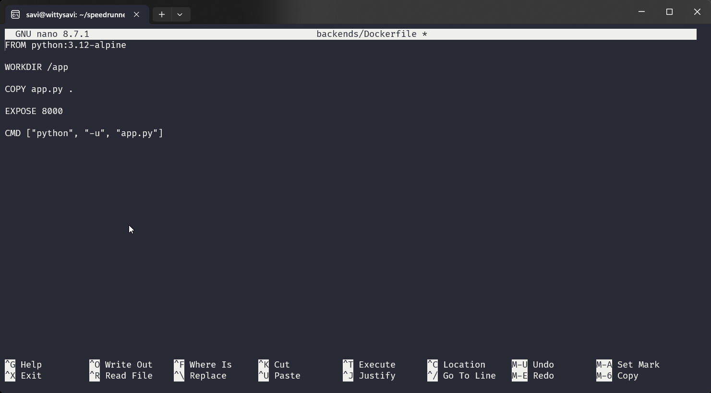

### 3. Configurar Nginx como balanceador

Seguimos con el archivo `nginx/nginx.conf`. Aquí definimos un bloque `upstream` con `backend1` y `backend2`, ambos escuchando internamente en el puerto 8000. Con `proxy_pass` indicamos que Nginx debía enviar las solicitudes a ese grupo de servidores.

Como todavía no agregamos ningún algoritmo especial, Nginx utilizó el balanceo _Round Robin_, que reparte las solicitudes entre los backends disponibles.

```bash
nano nginx/nginx.conf
```

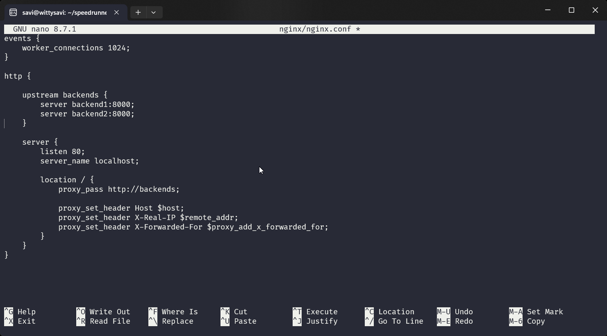

### 4. Crear Docker Compose y revisar los archivos

Ahora creamos `docker-compose.yml` en la carpeta principal. Allí declaramos los dos backends, el servicio de Nginx y el puerto `8090` para acceder desde Windows sin interferir con los puertos de las prácticas anteriores.

```bash
nano docker-compose.yml
```

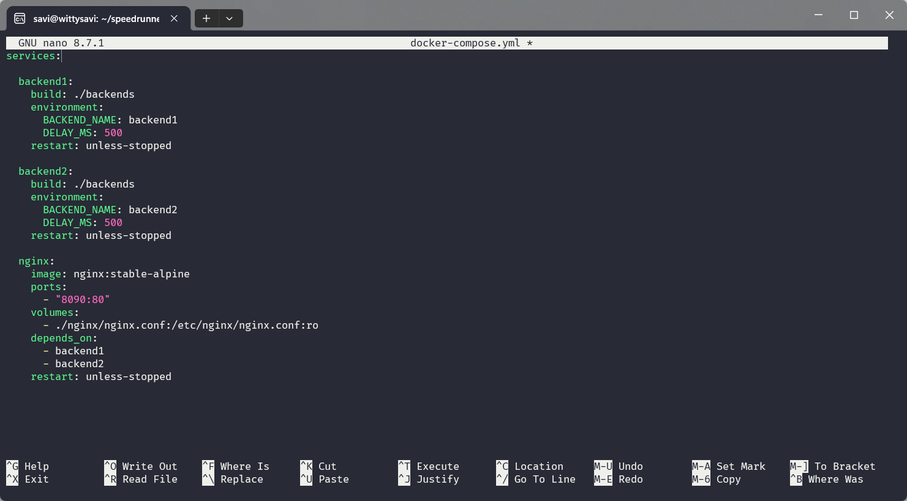

Antes de levantar los contenedores revisamos que la estructura y los archivos estuvieran en el lugar correcto.

```bash
find . -maxdepth 2 -type f | sort
```

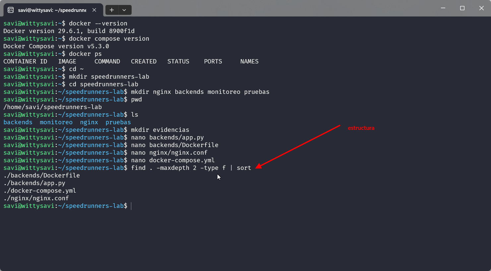

### 5. Levantar la infraestructura

Primero ejecutamos `docker compose config` para comprobar la configuración. Al no encontrar errores, construimos las imágenes y levantamos los servicios. Finalmente utilizamos `docker compose ps` para revisar su estado.

```bash
docker compose config
docker compose up -d --build
docker compose ps
```

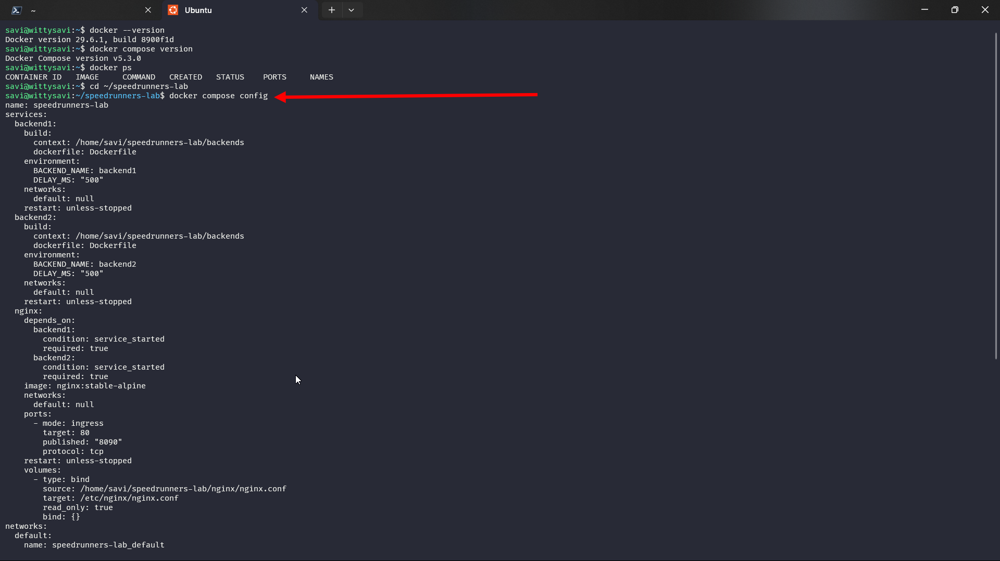

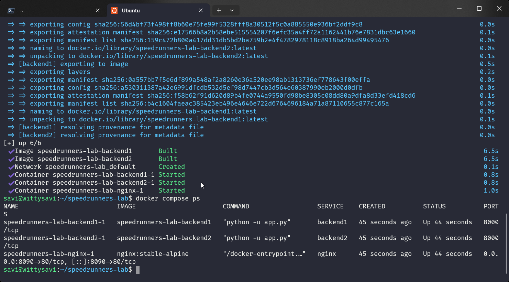

En este punto ya teníamos **tres contenedores activos**: `backend1`, `backend2` y `nginx`.

### 6. Comprobar el balanceo de carga

Después hicimos varias peticiones con `curl`, revisando la cabecera `X-Backend` para saber qué servidor atendía cada solicitud. En la captura podemos observar que las respuestas venían de los dos backends.

```bash
curl -s -D - -o /dev/null http://localhost:8090/ | grep -i X-Backend
```

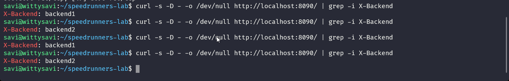

### 7. Medir la latencia inicial

Con la infraestructura funcionando, medimos cuánto tardaba en responder Nginx. Como cada backend tenía un retraso configurado de 500 ms, esperábamos respuestas de aproximadamente medio segundo.

```bash
curl -s -o /dev/null \
    -w "Tiempo total: %{time_total} segundos\n" \
    http://localhost:8090/
```


Para tener una medición un poco más confiable registramos diez solicitudes consecutivas en `pruebas/antes.csv`, con el número de solicitud, el código HTTP y el tiempo de respuesta.

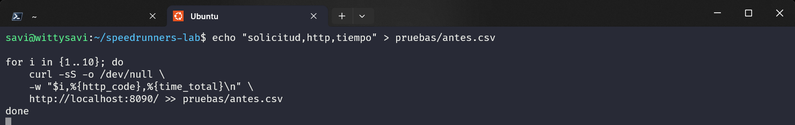

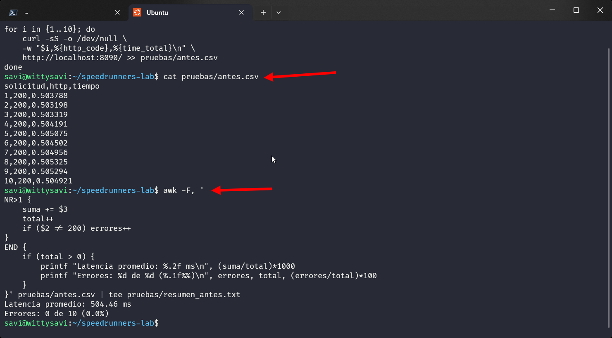

Luego usamos `awk` para calcular la latencia promedio y contar las respuestas que no fueran HTTP 200. El resultado quedó guardado en `pruebas/resumen_antes.txt`. En una de las comprobaciones intentamos abrirlo con extensión `.csv`, pero el archivo correcto era `.txt`; al corregir el nombre pudimos consultar el resumen sin problemas.

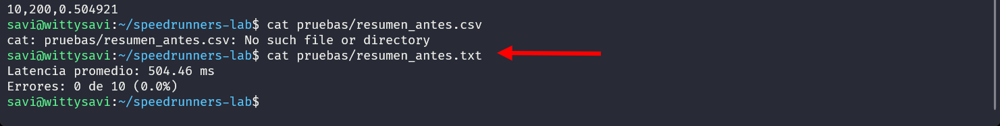

**Resultados del diagnóstico:**

| Métrica                        | Resultado inicial |
| ------------------------------ | ----------------: |
| Backends                       |                 2 |
| Retraso artificial por backend |            500 ms |
| Solicitudes medidas            |                10 |
| Latencia promedio              |     **504.46 ms** |
| Respuestas HTTP 200            |          10 de 10 |
| Errores observados             |           **0 %** |
| Caché de Nginx                 |    No configurada |
| Compresión Gzip                |    No configurada |

### Cuellos de botella identificados

Encontramos tres puntos que podíamos mejorar. El primero era el retraso artificial de 500 ms, que hacía lenta cada solicitud. El segundo era que no teníamos caché: aunque varias personas pidieran el mismo contenido, siempre debía consultarse un backend. El tercero era que solamente teníamos dos servidores para distribuir el trabajo, lo cual reducía la capacidad disponible bajo concurrencia.

Antes de continuar guardamos una copia de las configuraciones de la primera fase. Así podíamos comparar los cambios y recuperar los archivos iniciales si algo fallaba.

```bash
cp docker-compose.yml docker-compose.fase1.yml.bak
cp nginx/nginx.conf nginx/nginx.fase1.conf.bak
```

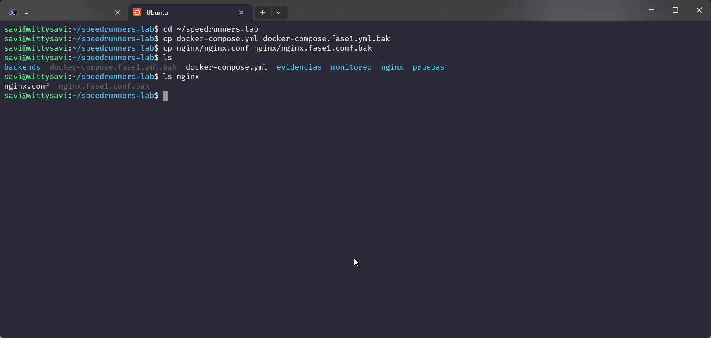

---

## Fase 2. Optimización de la infraestructura

### 1. Aumentar los backends y reducir el retraso

Abrimos nuevamente `docker-compose.yml`. Cambiamos el valor de `DELAY_MS` de 500 a 50 en los dos servidores existentes y agregamos `backend3` y `backend4` con la misma configuración. El puerto de acceso siguió siendo `8090`.

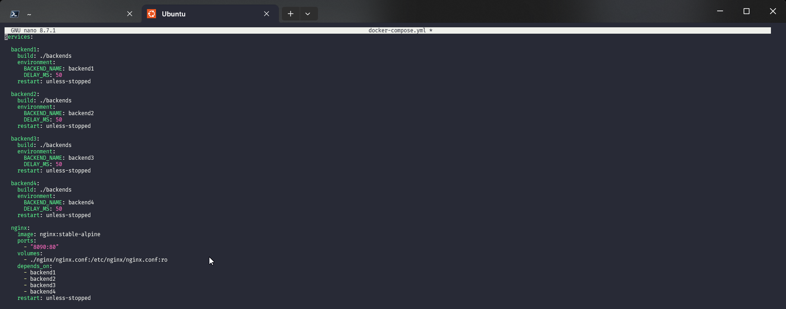

### 2. Configurar la caché, Gzip y least_conn

Ahora editamos `nginx/nginx.conf`. Las principales modificaciones fueron:

- `proxy_cache_valid 200 30s`: almacenar respuestas exitosas durante 30 segundos.
- `X-Cache-Status`: mostrar si Nginx entregó una respuesta desde caché (`HIT`) o tuvo que consultar el backend (`MISS`).
- `gzip on`: habilitar la compresión para enviar menos datos al cliente cuando este la soporte.
- `least_conn`: enviar nuevas solicitudes al backend con menos conexiones activas.
- `max_fails=3` y `fail_timeout=30s`: utilizar la detección **pasiva** de fallos de Nginx Open Source.

También agregamos un formato de registros para poder consultar después los tiempos y los estados de caché desde nuestro script de monitoreo.

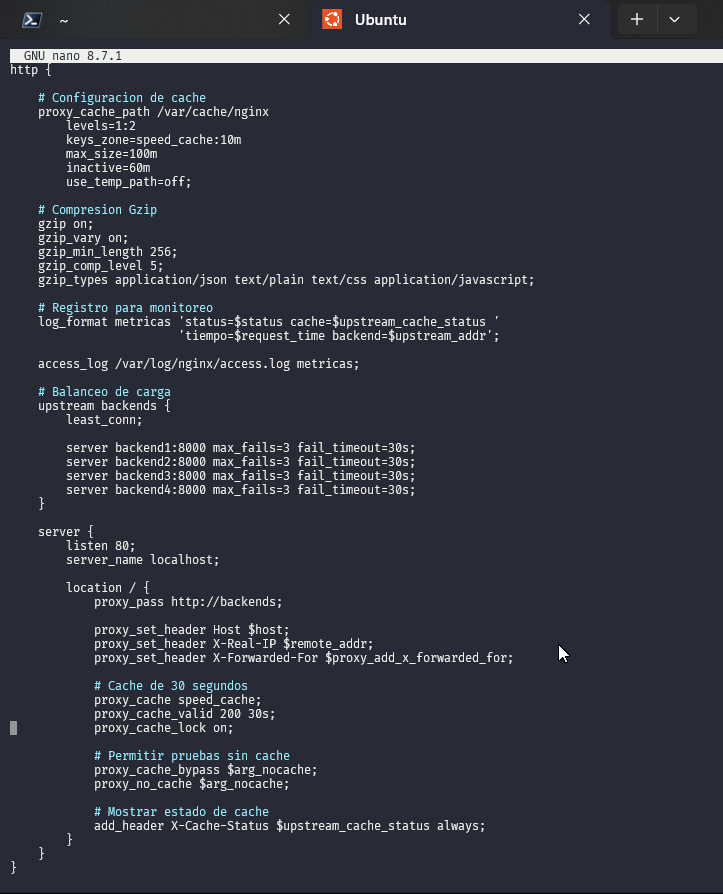

### 3. Aplicar la nueva configuración

Como habíamos cambiado los servicios, primero revisamos que Docker Compose aceptara la configuración. Después reconstruimos y levantamos los contenedores.

```bash
docker compose config
docker compose up -d --build
docker compose ps
```

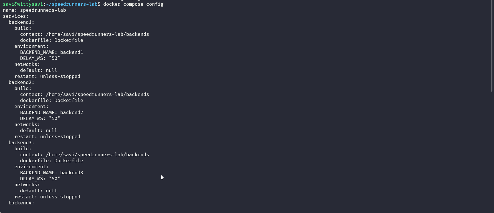

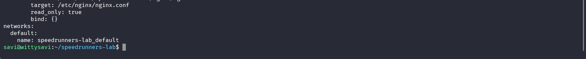

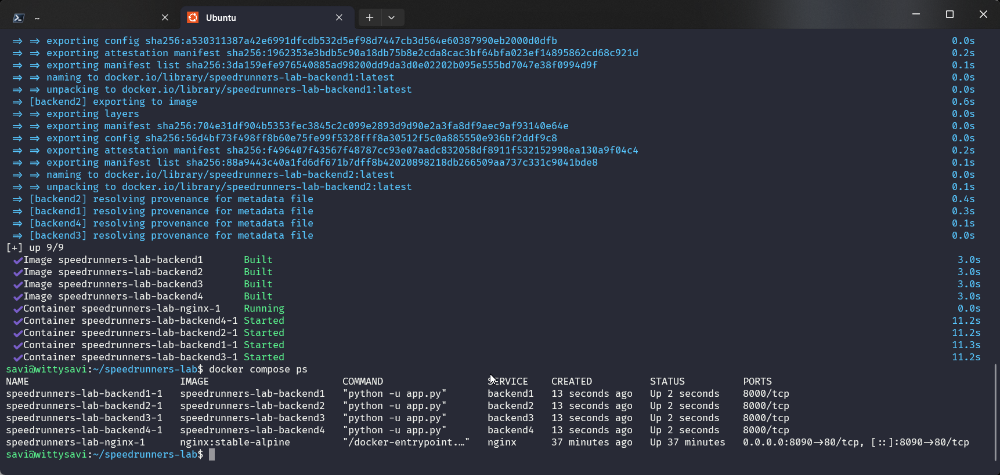

También validamos la sintaxis de Nginx con el comando siguiente:

```bash
docker compose exec nginx nginx -t
```

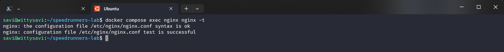

En este punto teníamos cinco contenedores en funcionamiento: cuatro backends y Nginx.

### 4. Comprobar que la caché funcionaba

Para probar la caché hicimos dos solicitudes consecutivas al mismo recurso. La primera devolvió `MISS`, ya que Nginx tuvo que consultar un backend. La segunda devolvió `HIT`, porque la respuesta ya estaba guardada.

```bash
for i in {1..2}; do
    curl -s -D - -o /dev/null \
        "http://localhost:8090/?prueba=cache_fase2" \
        | grep -i X-Cache-Status
done
```

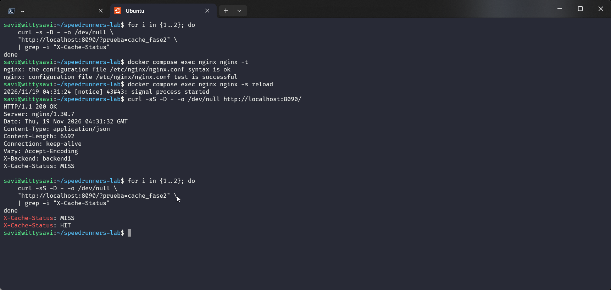

Esto comprobó que Nginx podía reutilizar una respuesta durante el tiempo configurado, sin enviarla nuevamente al backend.

### 5. Comprobar la compresión Gzip

Luego enviamos una solicitud que indicaba que el cliente aceptaba compresión Gzip. Nginx respondió con la cabecera `Content-Encoding: gzip`, así que confirmamos que esta mejora estaba activada.


### 6. Comprobar los cuatro backends

Realizamos doce peticiones sin usar la caché y revisamos nuevamente la cabecera `X-Backend`. En esta prueba aparecieron los cuatro servidores: `backend1`, `backend2`, `backend3` y `backend4`. Esto permitió comprobar que Nginx podía enviar tráfico a todos ellos.

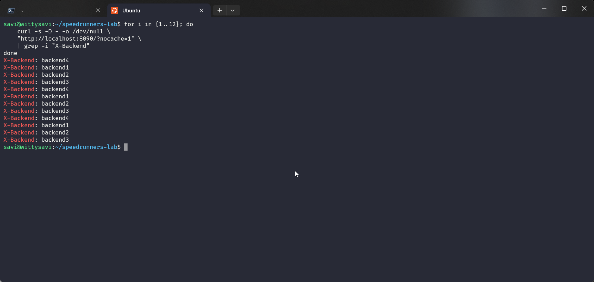

### 7. Medir la nueva latencia

Primero medimos una solicitud que debía pasar directamente a un backend, utilizando el parámetro `nocache=1`. En esa captura obtuvimos **0.055832 segundos (55.83 ms)**, un valor cercano al nuevo retraso artificial de 50 ms.

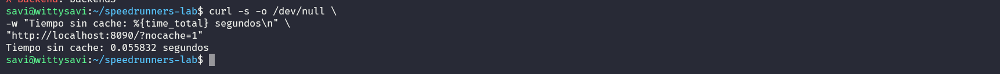

Después preparamos una respuesta en caché y registramos otras diez solicitudes en `pruebas/despues.csv`.

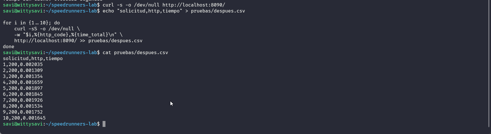

Al calcular el promedio, obtuvimos **1.70 ms** y ninguna respuesta distinta de HTTP 200 en esas diez solicitudes. Guardamos el resultado en `pruebas/resumen_despues.txt`.

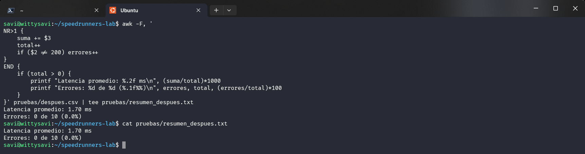

### Comparación antes y después

| Característica                    |         Antes |               Después |
| --------------------------------- | ------------: | --------------------: |
| Backends                          |             2 |                     4 |
| Retraso configurado               |        500 ms |                 50 ms |
| Caché                             |            No |           30 segundos |
| Compresión Gzip                   |            No |                    Sí |
| Balanceo                          |   Round Robin |     Least Connections |
| Latencia promedio en las muestras | **504.46 ms** | **1.70 ms con caché** |
| Errores en diez solicitudes       |           0 % |                   0 % |

La reducción observada de 504.46 ms a 1.70 ms fue de aproximadamente **99.66 %**. Hay que tomar en cuenta que la primera muestra no tenía caché, mientras que la segunda se midió con el contenido ya almacenado. Por eso, además de ese promedio, dejamos la medición de **55.83 ms sin caché** como evidencia del rendimiento directo de los backends optimizados.

---

## Fase 3. Monitoreo de los servidores

### 1. Incorporar cAdvisor

Antes de modificar los servicios guardamos un nuevo respaldo de Docker Compose.

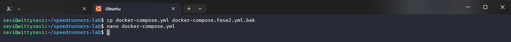

Agregamos el servicio `cadvisor` a `docker-compose.yml`. Lo configuramos para acceder desde Windows mediante el puerto `8085`. cAdvisor permite consultar información sobre contenedores y recursos del entorno Docker.

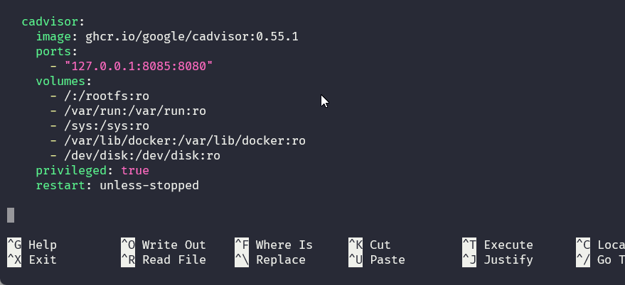

Validamos y levantamos nuevamente los servicios. Al revisar `docker compose ps`, ya aparecían los cuatro backends, Nginx y cAdvisor: **seis contenedores** en total.

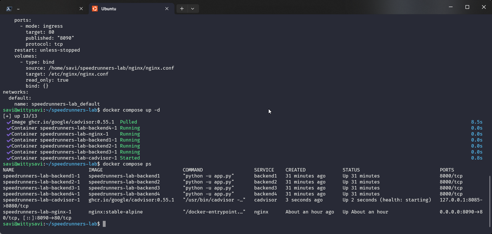

Después abrimos `http://localhost:8085` en el navegador. Allí pudimos entrar a la interfaz de cAdvisor y visualizar las opciones disponibles para consultar información del sistema y los contenedores.

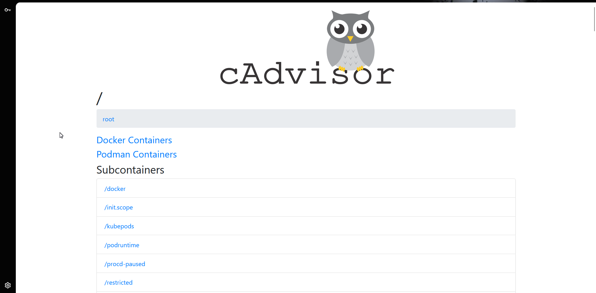

### 2. Habilitar las estadísticas de Nginx

También agregamos `stub_status` dentro de `nginx/nginx.conf`, en la ruta `/nginx_status`. Esto sirve para conocer las conexiones activas y los contadores de solicitudes atendidas por Nginx.


Para que el proxy quedara accesible solamente desde nuestro equipo, cambiamos la publicación del puerto a `127.0.0.1:8090:80`. Luego aplicamos los cambios y comprobamos otra vez la configuración de Nginx.


Probamos el endpoint con `curl`:

```bash
curl http://localhost:8090/nginx_status
```

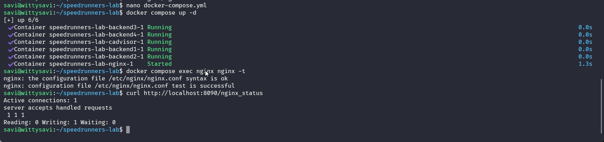

También abrimos esa misma ruta en el navegador para comprobar que los datos podían consultarse directamente.

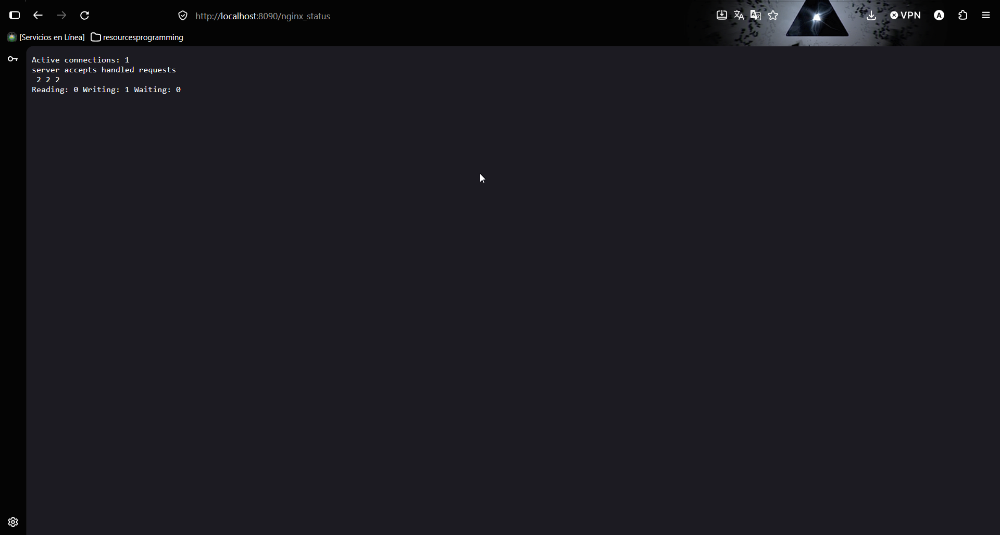

Los números de conexiones cambian con cada solicitud, así que pueden variar entre una captura y otra.

### 3. Consultar CPU, memoria y registros

Antes de crear el dashboard comprobamos que Docker ya podía entregarnos el consumo de CPU y memoria de los contenedores.

```bash
docker stats --no-stream
```

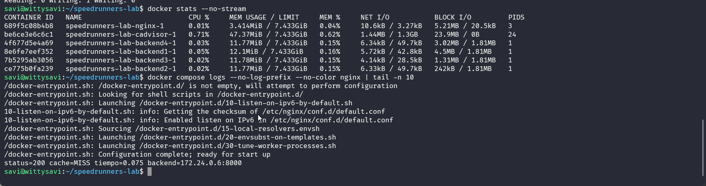

También consultamos los últimos registros de Nginx, que habíamos preparado en la Fase 2 para guardar el estado de caché, el tiempo de respuesta y el backend utilizado.

```bash
docker compose logs --no-log-prefix --no-color nginx | tail -n 10
```

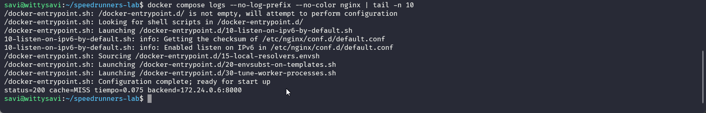

### 4. Crear nuestro dashboard con Bash

Ahora creamos `monitoreo/dashboard.sh`. Este script consulta periódicamente las últimas diez solicitudes registradas por Nginx, calcula su latencia promedio, cuenta los aciertos y fallos de caché (`HIT` y `MISS`), obtiene las conexiones activas y recoge las métricas de CPU y memoria con `docker stats`.

Además de mostrar los datos en la terminal, el mismo script genera `monitoreo/reporte.html` para visualizar las métricas desde el navegador.

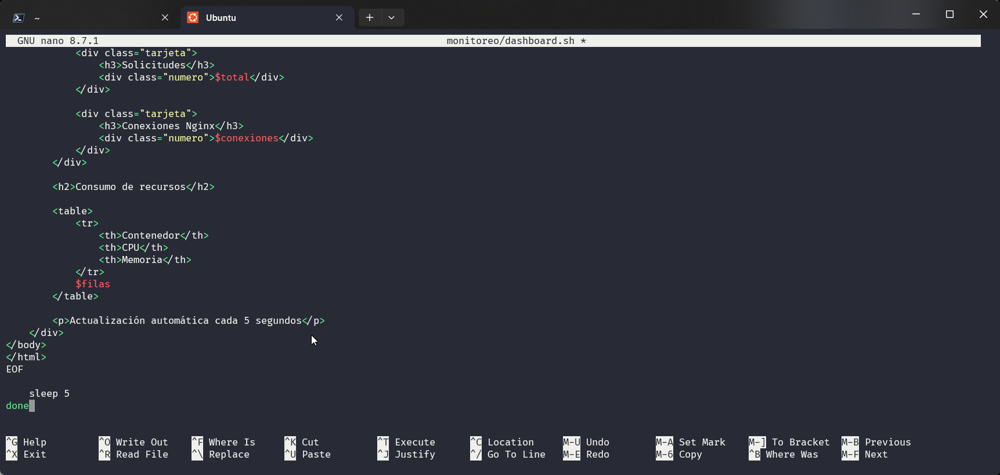

Le dimos permisos de ejecución:

```bash
chmod +x monitoreo/dashboard.sh
```


Luego lo ejecutamos desde la carpeta principal:

```bash
./monitoreo/dashboard.sh
```


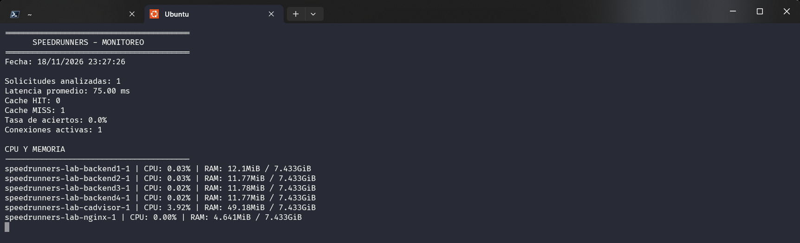

### 5. Mostrar el dashboard en el navegador

En una segunda terminal de Ubuntu iniciamos un servidor HTTP de Python para publicar el archivo HTML generado por el script, utilizando el puerto `8092`.

```bash
python3 -m http.server 8092 \
    --bind 127.0.0.1 \
    --directory monitoreo
```

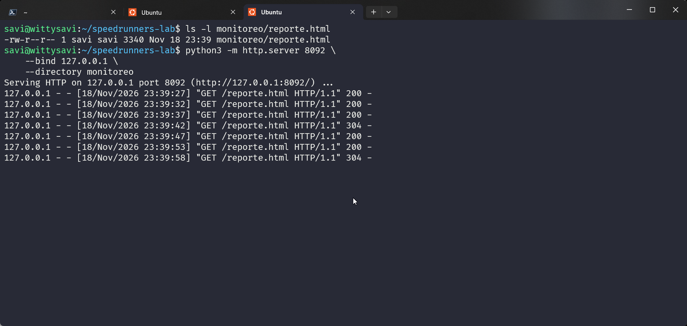

Después abrimos `http://localhost:8092/reporte.html` desde Windows. Allí pudimos ver un panel con tarjetas de latencia, porcentaje de caché, solicitudes y conexiones, además de una tabla con CPU y memoria de cada contenedor. El HTML se actualiza cada cinco segundos mientras `dashboard.sh` siga ejecutándose.

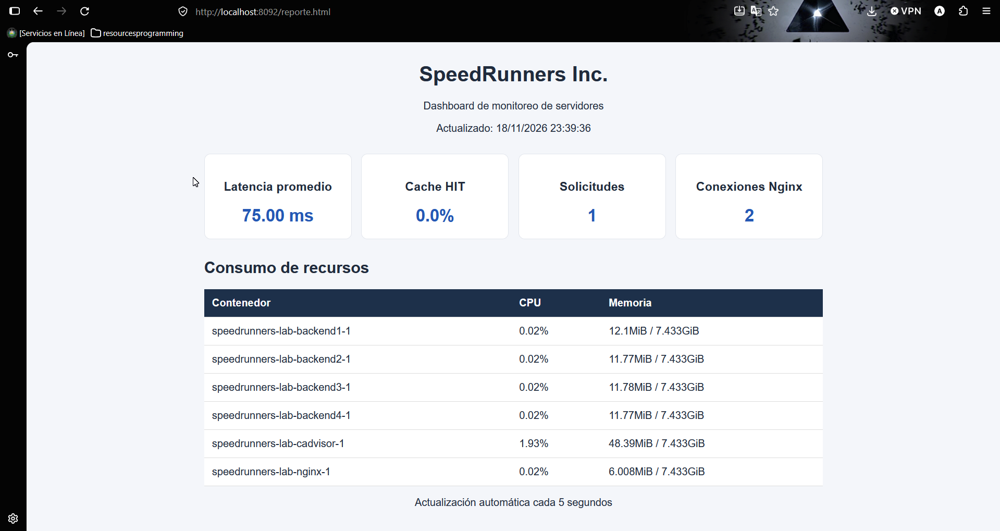

**Qué aprendimos en esta fase:** el monitoreo nos permite ver lo que está pasando dentro de la infraestructura y comprobar que los servicios siguen respondiendo. Los valores del dashboard son fotografías de momentos distintos; como se calculan a partir de las últimas diez peticiones registradas, cambian cuando generamos más tráfico y no deben confundirse con el promedio de toda una prueba de estrés.

---

## Fase 4. Pruebas de estrés

### 1. Instalar Apache Benchmark

Primero actualizamos los paquetes de Ubuntu, instalamos `apache2-utils` y comprobamos que la herramienta `ab` estuviera disponible.

```bash
sudo apt update
sudo apt install apache2-utils -y
ab -V
```


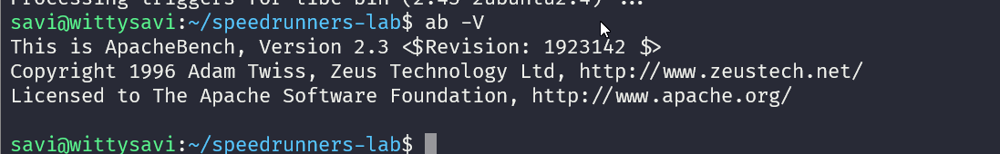

### 2. Preparar el monitoreo para las pruebas

Dejamos el dashboard funcionando en una terminal y el servidor Python del HTML en otra. Así podíamos revisar los recursos mientras se ejecutaban las solicitudes de Apache Benchmark.

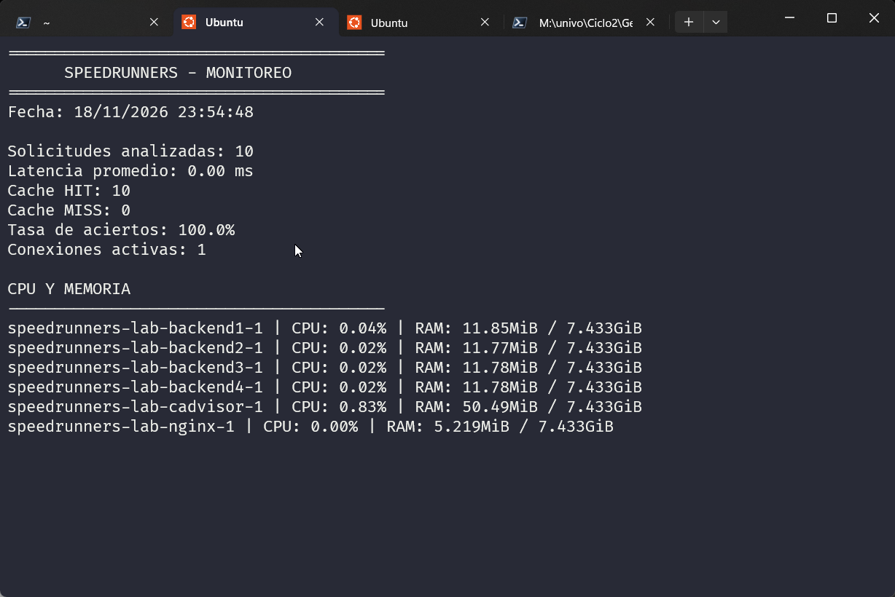

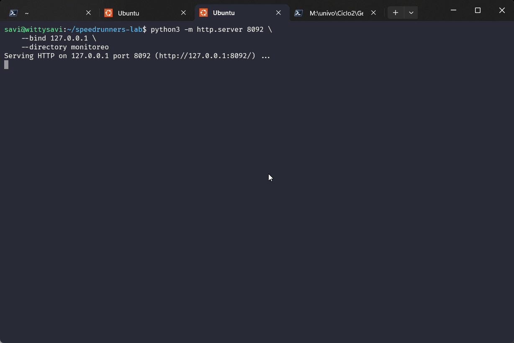

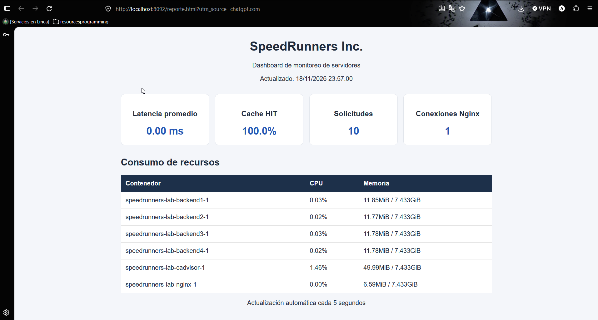

### 3. Comprobar que Nginx seguía respondiendo

Antes de comenzar utilizamos `curl -I` para confirmar que Nginx respondía correctamente. En la captura aparece el código `HTTP/1.1 200 OK` y un estado de caché `EXPIRED`, que indica que había una entrada anterior cuya vigencia había terminado.

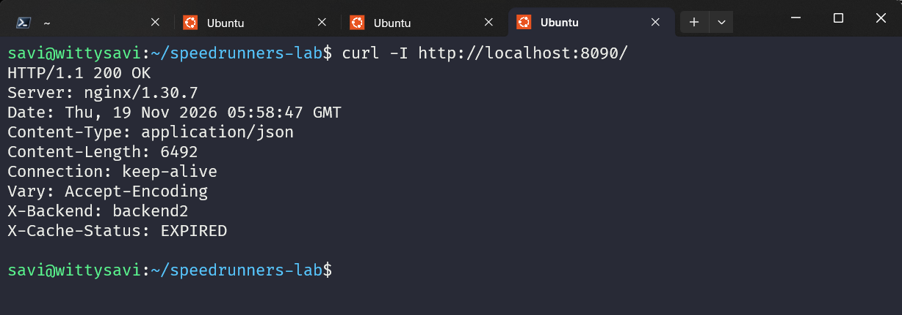

### 4. Primera prueba: con caché

Calentamos la caché con una solicitud normal y después ejecutamos 1,000 solicitudes con una concurrencia de 100, guardando el resultado en `pruebas/estres_cache.txt`.

```bash
curl -s -o /dev/null http://127.0.0.1:8090/

ab -n 1000 -c 100 -s 30 \
    http://127.0.0.1:8090/ \
    | tee pruebas/estres_cache.txt
```

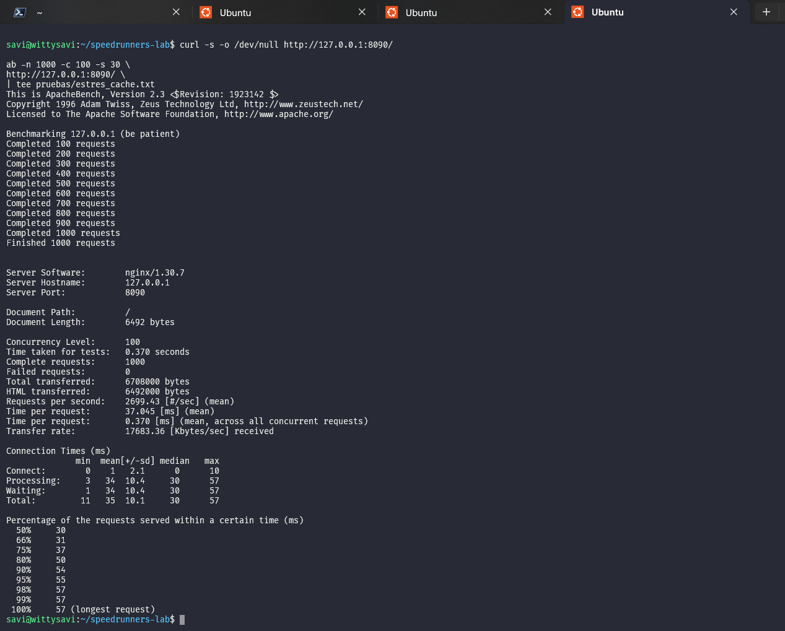

La prueba terminó con **1,000 solicitudes completadas y 0 fallidas**. Según el archivo guardado, Nginx procesó aproximadamente **3,354.06 solicitudes por segundo**, con `Time per request` de **29.815 ms** y percentil 95 de **31 ms**.

### 5. Segunda prueba: sin caché

Luego repetimos la prueba usando `?nocache=1`. Ese parámetro permite evitar el uso y el almacenamiento de la respuesta en la caché, según la configuración que habíamos agregado a Nginx.

```bash
ab -n 1000 -c 100 -s 30 \
    "http://127.0.0.1:8090/?nocache=1" \
    | tee pruebas/estres_sin_cache.txt
```

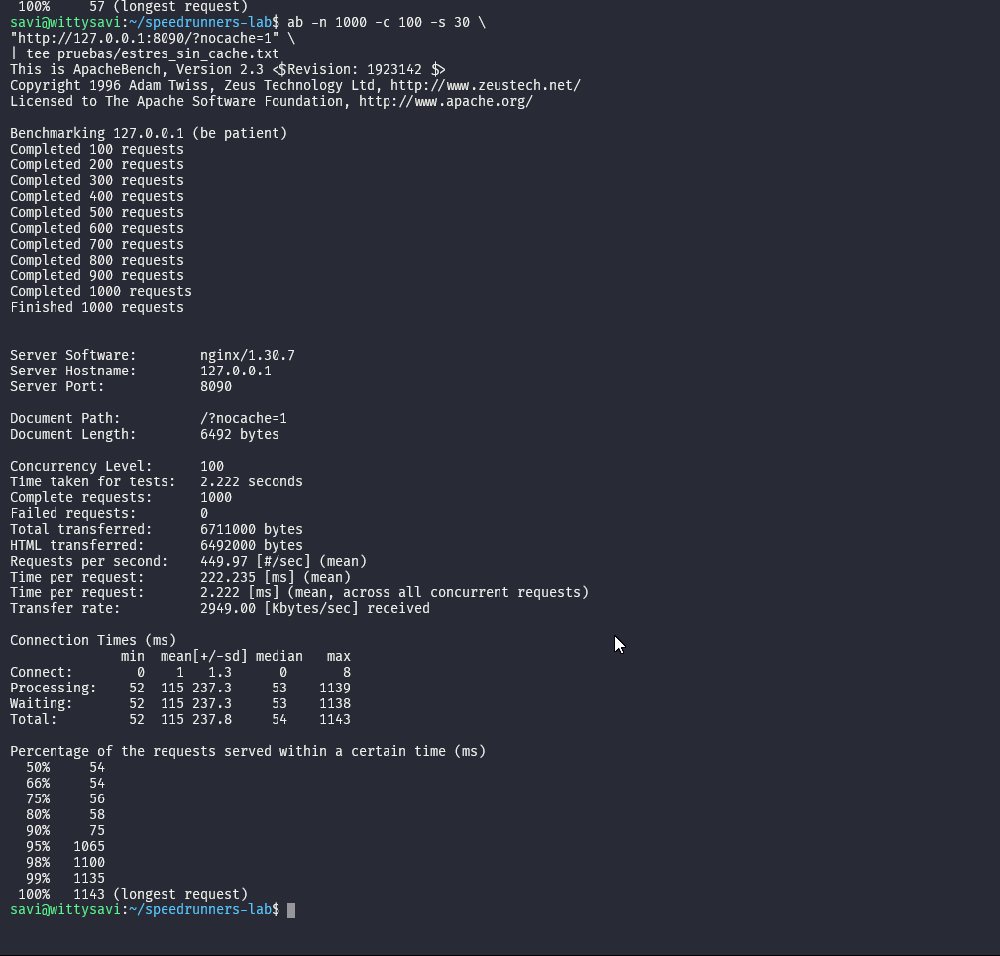

En este caso también se completaron las **1,000 solicitudes sin fallos**, pero el rendimiento fue menor: **574.19 solicitudes por segundo**, `Time per request` de **174.159 ms** y percentil 95 de **88 ms**. El tiempo máximo de una solicitud llegó a **1,088 ms**, lo que también muestra que algunas peticiones tardaron bastante más que el promedio cuando hubo concurrencia.

### 6. Crear el script de pruebas

Para no tener que escribir todos los comandos cada vez, creamos `pruebas/stress-test.sh`. El script comprueba que Nginx responde, ejecuta las dos pruebas y guarda los resultados en archivos de texto.


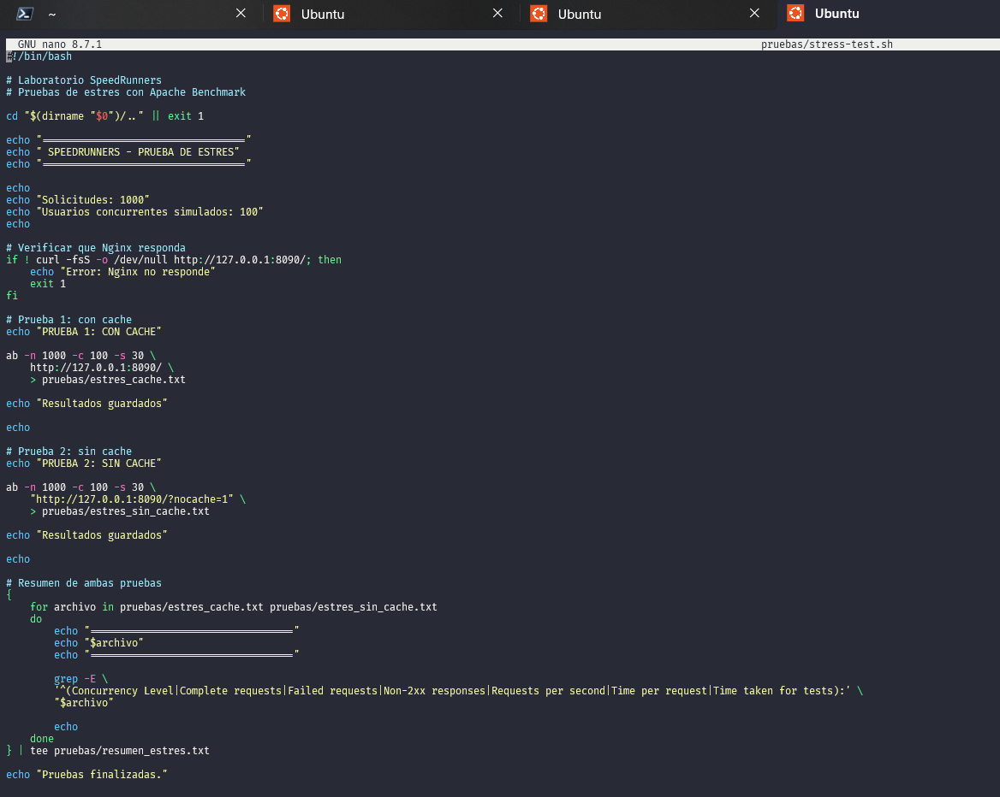

Le asignamos permisos de ejecución y comprobamos que podíamos repetir las pruebas desde la terminal:

```bash
chmod +x pruebas/stress-test.sh
./pruebas/stress-test.sh
```

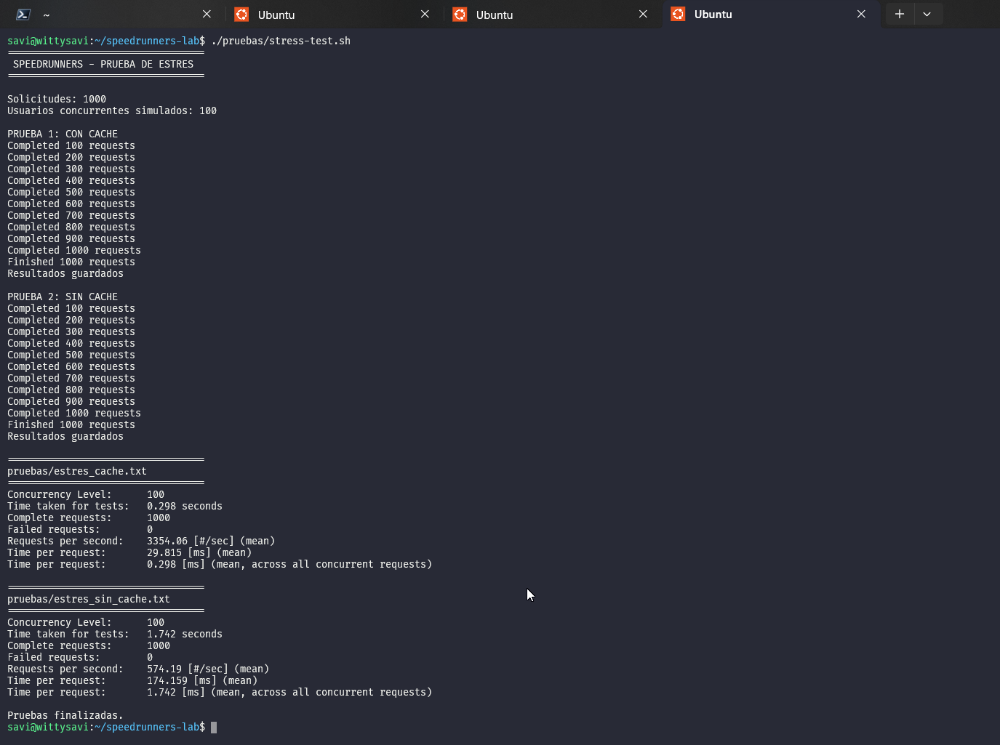

### 7. Revisar los resultados finales

El script también generó un resumen en `pruebas/resumen_estres.txt`, que consultamos con `cat`.

```bash
cat pruebas/resumen_estres.txt
```

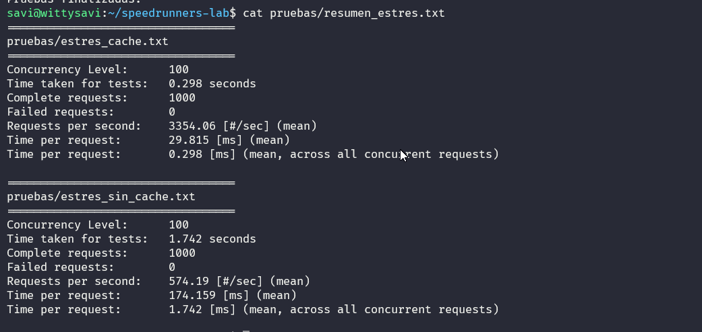

Esta es la comparación obtenida de los archivos `estres_cache.txt` y `estres_sin_cache.txt`:

| Métrica                                    |    Con caché |  Sin caché |
| ------------------------------------------ | -----------: | ---------: |
| Solicitudes concurrentes                   |          100 |        100 |
| Solicitudes completadas                    |        1,000 |      1,000 |
| Solicitudes fallidas                       |        **0** |      **0** |
| Duración total                             |      0.298 s |    1.742 s |
| Solicitudes por segundo                    | **3,354.06** | **574.19** |
| `Time per request` (primera línea de `ab`) |    29.815 ms | 174.159 ms |
| Percentil 95                               |        31 ms |      88 ms |
| Solicitud más lenta                        |        32 ms |   1,088 ms |

Con caché se atendieron aproximadamente **5.84 veces más solicitudes por segundo** que sin caché. El tiempo `Time per request` informado por Apache Benchmark también fue alrededor de **82.88 % menor**. Estos valores corresponden a la prueba concurrente y no son exactamente la misma medición que los 1.70 ms obtenidos anteriormente con `curl`.

Para completar las evidencias, también guardamos una captura del dashboard después de generar carga. En ella aparece una latencia instantánea de **367.60 ms** calculada por el script a partir de las últimas diez solicitudes de ese momento. Esa cifra puede diferir de los resultados globales de Apache Benchmark porque cada herramienta mide una ventana distinta.


---

## Fase 5. Presentación de los resultados

### Las tres mejoras que más destacamos

**Reducir el retraso de los backends.** Pasamos de 500 ms a 50 ms de espera artificial. Esto hizo que incluso las solicitudes sin caché respondieran más rápido que al principio.

**Agregar caché en Nginx.** Fue especialmente útil cuando varias solicitudes pedían el mismo contenido, porque Nginx podía entregar una respuesta guardada en lugar de enviarla otra vez a Python. En la prueba de estrés se vio claramente la diferencia entre trabajar con caché y sin ella.

**Aumentar los servidores y cambiar el balanceo.** Con cuatro backends y `least_conn`, Nginx tuvo más opciones para distribuir las conexiones. La prueba de las cabeceras `X-Backend` confirmó que los cuatro podían recibir solicitudes. Los mecanismos pasivos de detección de fallos quedaron configurados, aunque no realizamos una prueba específica de caída de contenedores en las evidencias presentadas.

### Preguntas de reflexión

**1. ¿Cuál fue el cuello de botella más crítico y cómo lo resolvimos?**  
Al principio, el retraso artificial de 500 ms era el problema más evidente. Lo redujimos a 50 ms. Además, la falta de caché obligaba a consultar el backend para cada petición, así que activamos una caché de 30 segundos en Nginx.

**2. ¿Qué métrica mejoró más?**  
En las muestras de diez solicitudes, la latencia promedio pasó de 504.46 ms a 1.70 ms con caché, una reducción aproximada del 99.66 %. También vimos que, bajo concurrencia, la cantidad de solicitudes por segundo fue mucho mayor con caché que sin ella.

**3. ¿Qué técnica de caché usamos y por qué?**  
Usamos `proxy_cache` de Nginx, con un TTL de 30 segundos. La elcogi porque era sencilla de configurar para respuestas HTTP y permitía comprobar su funcionamiento con las cabeceras `MISS` y `HIT`.

**4. ¿Cómo afectó el balanceo de carga?**  
El balanceo permitió que Nginx repartiera peticiones entre cuatro backends, en lugar de depender solamente de dos. La prueba de `X-Backend` mostró que los cuatro estaban disponibles. Eso no significa que cada petición tarde exactamente lo mismo, pero sí que el trabajo puede distribuirse.

**5. ¿Qué haríamos para llegar a 100,000 usuarios?**  
No bastaría con agregar más contenedores en una sola computadora. Haría falta distribuir la infraestructura entre varios servidores, automatizar el escalado, incorporar una CDN para recursos estáticos, revisar las bases de datos y contar con monitoreo y alertas más completos. También tendríamos que hacer pruebas de carga mucho mayores: en este laboratorio validamos hasta 100 solicitudes concurrentes, no 10,000 ni 100,000 usuarios reales.

**6. ¿Qué aprendimos sobre el monitoreo?**  
Aprendimos que no alcanza con saber que un contenedor está encendido. Con cAdvisor, `docker stats`, `stub_status` y nuestro dashboard pudimos revisar conexiones, consumo de recursos y respuestas atendidas por caché. Estos datos ayudan a detectar problemas y a entender mejor los resultados de las pruebas.

### Conclusión

Este laboratorio nos permitió ver la diferencia entre tener un servidor funcionando y tenerlo preparado para responder mejor cuando aumenta el tráfico. Primero levantamos una infraestructura sencilla, medimos sus tiempos y encontramos qué se podía mejorar. Después aplicamos caché, compresión, balanceo y más backends, y comprobamos los cambios con solicitudes reales.

Lo que más nos llamó la atención fue la diferencia que hizo la caché. Con ella, Nginx pudo responder muchas solicitudes sin repetir el trabajo del backend. También comprobamos que era importante guardar los resultados y tener un dashboard, porque así podemos explicar las mejoras con datos y no solamente decir que el sistema se siente más rápido.

Las pruebas no representan todavía una infraestructura lista para producción ni demuestran que pueda manejar 10,000 usuarios concurrentes, pero sí cumplieron el objetivo de aprender a diagnosticar, optimizar, monitorear y poner a prueba un entorno de servidores usando Ubuntu y Docker.

## Archivos entregados

Los archivos principales que acompañan el informe son:

- `docker-compose.yml`: definición de los servicios y sus puertos.
- `backends/app.py` y `backends/Dockerfile`: aplicación Python y construcción de su imagen.
- `nginx/nginx.conf`: proxy inverso, caché, Gzip, balanceo y estadísticas.
- `monitoreo/dashboard.sh` y `monitoreo/reporte.html`: panel de monitoreo.
- `pruebas/stress-test.sh`: automatización de las pruebas con Apache Benchmark.
- `pruebas/antes.csv`, `pruebas/despues.csv`, los resúmenes y los resultados de estrés: datos utilizados en las comparaciones.
- `evidencias/imagen1.png` a `evidencias/imagen56.png`: capturas del laboratorio en el orden original.

### Comandos útiles para volver a mostrar el proyecto

Desde Ubuntu, con Docker Desktop iniciado:

```bash
cd ~/speedrunners-lab
docker compose up -d --build
docker compose ps
```

Para ejecutar el monitoreo, en otra terminal:

```bash
./monitoreo/dashboard.sh
```

Y para abrir el dashboard HTML desde Windows, iniciamos el servidor web en otra terminal:

```bash
python3 -m http.server 8092 --bind 127.0.0.1 --directory monitoreo
```

Después ingresamos a `http://localhost:8092/reporte.html`. Si queremos repetir las pruebas de estrés, utilizamos `./pruebas/stress-test.sh`.
